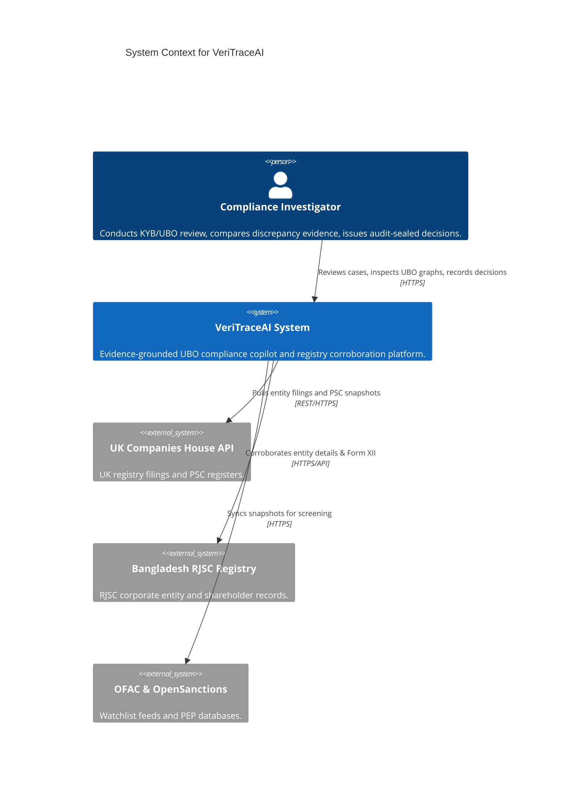
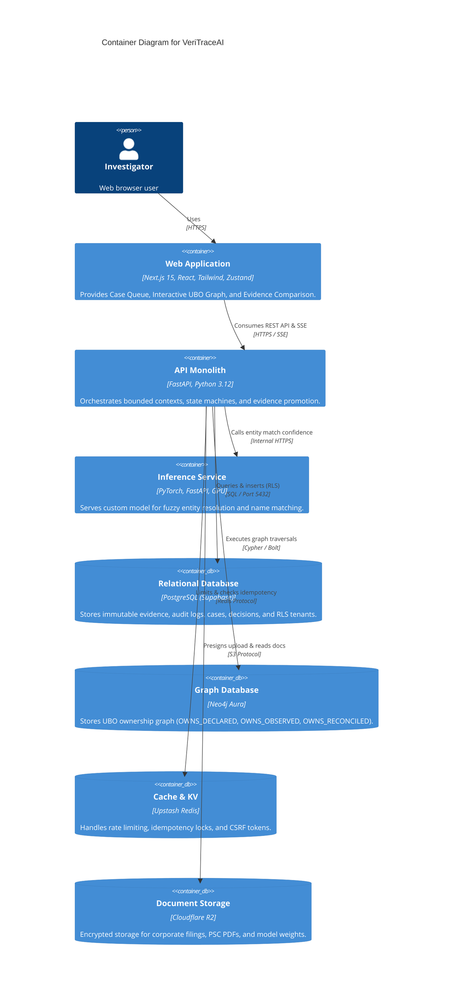

# VeriTraceAI — C4 Architectural Diagrams

> System Architecture visualization following the C4 Model (Context, Container, Component).
> References [Decision [#7](../adr/02-strategic-design/ADR-0007-entity-person-address-as-shared-reference-data.md)](../adr/02-strategic-design/ADR-0007-entity-person-address-as-shared-reference-data.md), [#8](../adr/02-strategic-design/ADR-0008-ownership-representation-relational-graph-dual-store.md), [#59](../adr/08-frontend-ui/ADR-0059-hosting-cloudflare-pages-workers.md), [#66](../adr/09-infrastructure-hosting/ADR-0066-api-hosting-aws-ecs-fargate.md), [#72](../adr/09-infrastructure-hosting/ADR-0072-production-gpu-hosting-ecs-mixed-capacity-provider-cluster-not-sagemaker-revised.md).

---

## 1. System Context Diagram (Level 1)

---

## 2. Container Diagram (Level 2)

