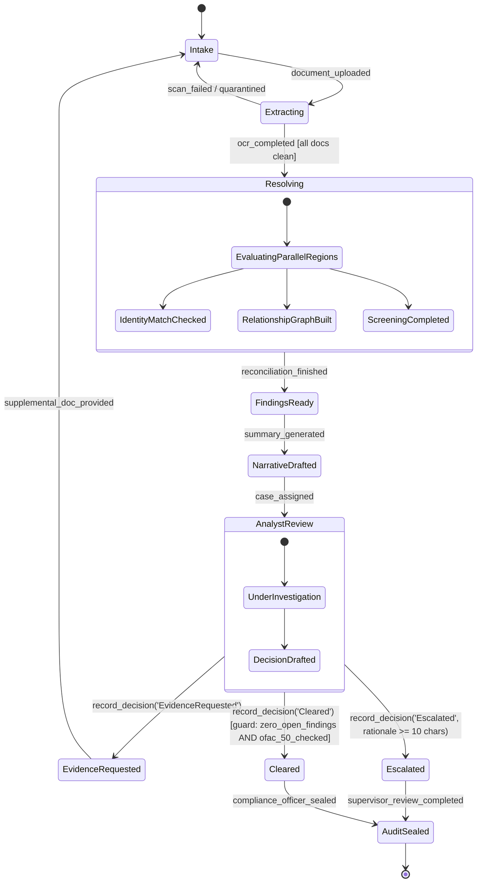
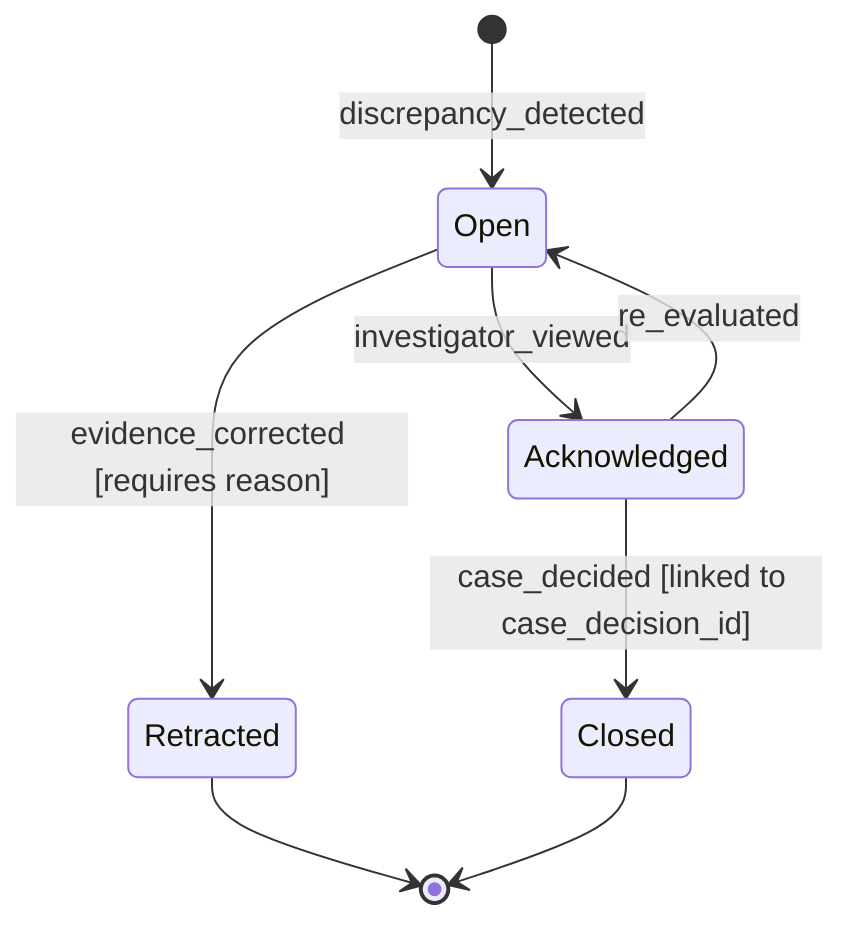
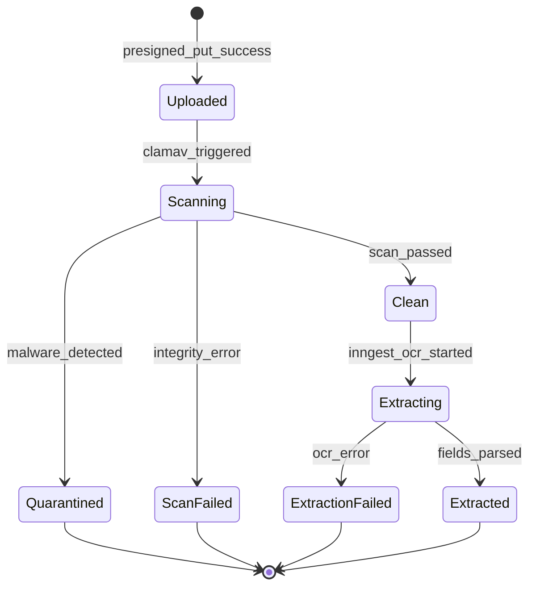

# VeriTraceAI — State Machine & Transition Specifications

> Formal transition specifications for Case, Finding, Document, and Screening Lifecycles.
> Enforces [Decision [#18](../adr/03-data-modeling/ADR-0018-case-status-and-region-status-as-explicit-postgres-enums.md)](../adr/03-data-modeling/ADR-0018-case-status-and-region-status-as-explicit-postgres-enums.md), [#29](../adr/05-state-machine/ADR-0029-case-lifecycle-states.md), [#30](../adr/05-state-machine/ADR-0030-finding-lifecycle-states.md), [#31](../adr/05-state-machine/ADR-0031-document-lifecycle-states.md), and [#79](../adr/10-mvp-simulation/ADR-0079-shared-state-machine-logic-simulation-matches-real-rules.md).

---

## 1. Case Lifecycle Statechart

The `Case` aggregate lifecycle is modeled as an explicit statechart with orthogonal regions:

### 1.1 Transition Guard Rules

1. **`AnalystReview -> Cleared` Guard**:
   - `COUNT(findings WHERE status = 'open') == 0`.
   - `screening_match_region == 'computed'`.
   - `case_decisions.ofac_50_rule_checked == true`.
   - Violation produces RFC 7807 error: `urn:veritrace:error:state_machine:unresolved_findings`.

2. **`AnalystReview -> Escalated` Guard**:
   - `rationale` must be provided, non-empty, and minimum 10 characters.
   - Insert-only record created in `case_evidence.case_decisions`.

3. **`AnalystReview -> EvidenceRequested` Guard**:
   - Requires citing at least one specific ambiguous finding or uncorroborated entity edge.

---

## 2. Finding Lifecycle

A `Finding` represents an atomic discrepancy between declared and corroborated evidence.

### 2.1 Invariance Rules
- A case cannot move to `Cleared` while any associated finding has status `Open` or `Acknowledged`.
- A finding cannot be deleted; closing or retracting appends a timestamped audit trail.

---

## 3. Document Processing Pipeline State

